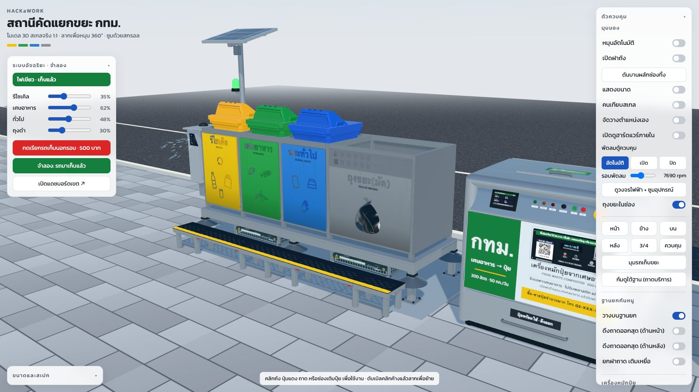
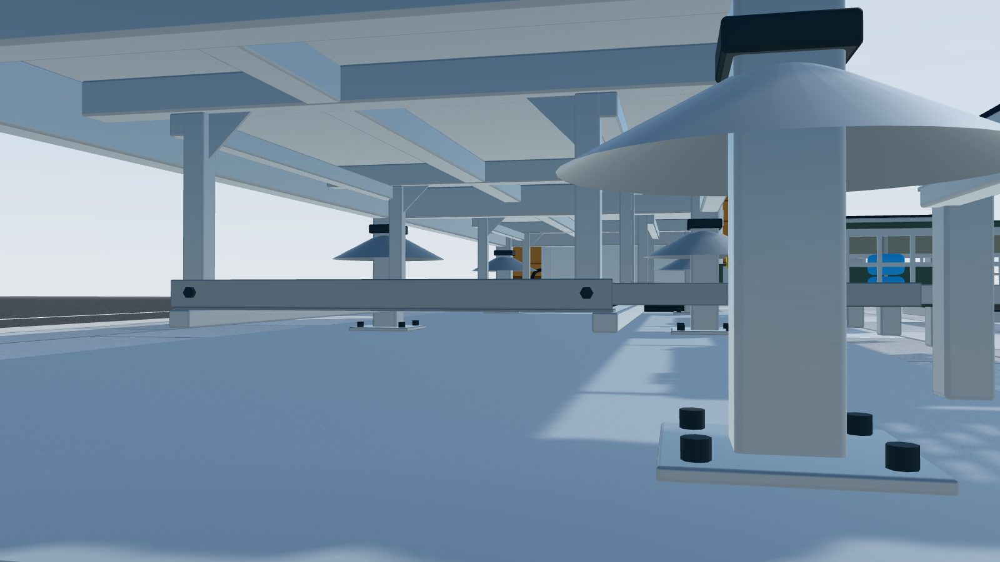
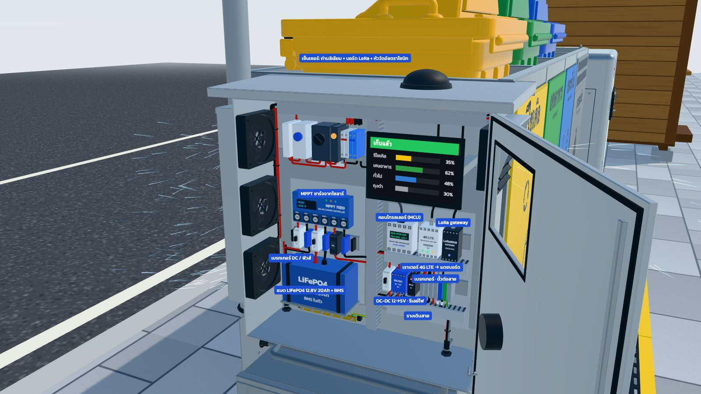
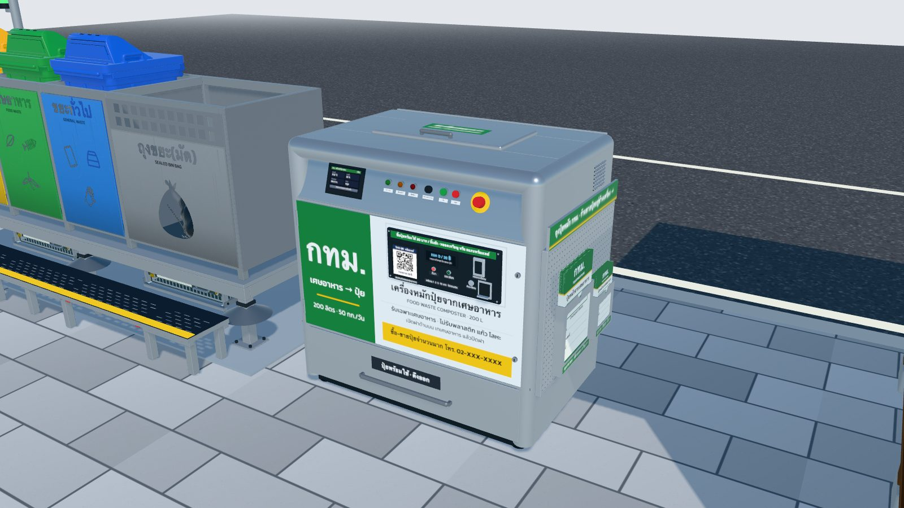
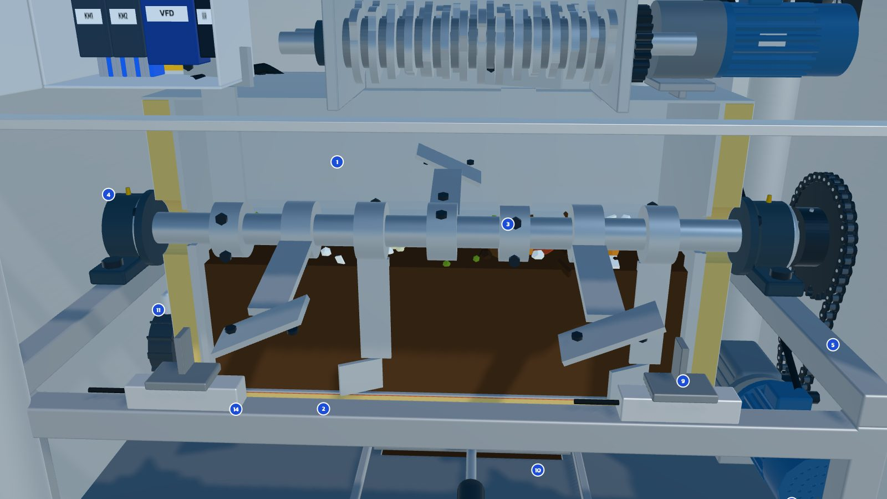
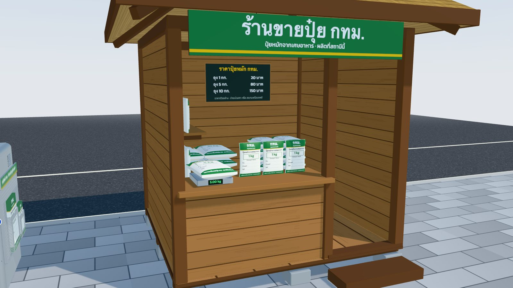
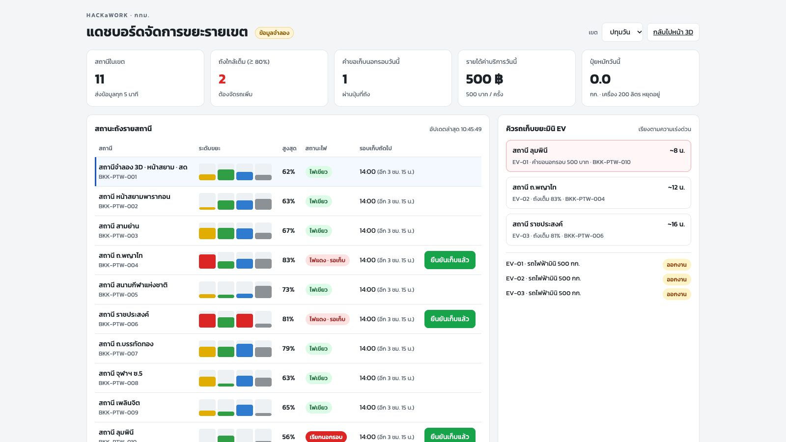

# HACKaWORK — BKK Bin Station 3D

A true-to-scale (1 unit = 1 m) 3D web model of a Bangkok (BMA) 4-bay sidewalk waste-sorting station,
extended with an anti-rodent raised base, smart hardware, a food-waste composter, a compost shop,
an electric mini garbage truck and a district dashboard.



**Try it without installing anything**

- 3D model: <https://pug-03.github.io/HACKaWORK/>
- District dashboard: <https://pug-03.github.io/HACKaWORK/dashboard.html>

> This is a concept prototype. It is not connected to real devices, and the on-screen text is in Thai.
> See [Simulated data and placeholders](#simulated-data-and-placeholders) for what isn't real.

## Run it locally

The project is plain HTML and JavaScript: there is no build step and no `npm install`.
You only need one way to serve the folder.

**1. Get the code**

```bash
git clone https://github.com/Pug-03/HACKaWORK.git
cd HACKaWORK
```

**2. Start a server** using whichever row matches your machine

| You have | Command |
|---|---|
| npm and Python 3 (macOS / Linux) | `npm run dev` |
| Python 3 (macOS / Linux) | `python3 -m http.server 8766` |
| Python 3 (Windows) | `py -m http.server 8766` |
| Node.js only | `npx serve -l 8766` |

**3. Open it in your browser**

- 3D model: <http://localhost:8766>
- Dashboard: <http://localhost:8766/dashboard.html>

Press `Ctrl + C` in the terminal to stop the server. You need an internet connection, because
three.js and the font load from a CDN.

## Versions

| Item | Version | Notes |
|---|---|---|
| [three.js](https://threejs.org/) | `0.170.0` (r170) | Loaded from jsDelivr, nothing to install |
| Kanit font | n/a | Loaded from Google Fonts |
| Python | 3.x | Tested with 3.9.6 |
| Node.js / npm | Optional | Tested with Node 26.7.0 and npm 11.19.0 |
| `serve` | Optional | Fetched by `npx`, tested with 14.2.7 |
| Browser | Chrome / Edge 89+, Safari 16.4+, Firefox 108+ | Needs WebGL and import maps |

Testing so far has been on macOS with Chrome. The Windows command and other browsers haven't been
tried on real setups yet, so please [open an issue](https://github.com/Pug-03/HACKaWORK/issues) if
something doesn't work.

**Project version:** there are no version numbers or releases yet, so `main` is always the latest.

```bash
git log -1 --oneline   # see which commit you have
git pull               # update to the latest
```

**Changing the three.js version:** update every `three@0.170.0` in `index.html`, in both the import
map and the `modulepreload` lines.

## Troubleshooting

| Problem | Fix |
|---|---|
| Double-clicking `index.html` doesn't show the model | Use a local server as shown above; `file://` can't load ES modules |
| `python3` isn't found, or `npm run dev` fails | On Windows use `py -m http.server 8766`, or use `npx serve -l 8766` |
| Port 8766 is already in use | Use another number in both the command and the URL, such as `8767` |
| The page says scripts or the model failed to load | Check your internet connection; three.js loads from a CDN |
| The page says WebGL isn't supported | Update your browser or turn on hardware acceleration |
| The page doesn't change after editing or `git pull` | Hard-refresh with `Cmd/Ctrl + Shift + R` |
| The dashboard doesn't follow the 3D page | Open both pages in the same browser and from the same address |

## How to use it

| To do this | Do this |
|---|---|
| Orbit the camera | Drag on the scene |
| Zoom | Scroll, or pinch with two fingers |
| Jump to a preset view | Use the view buttons in the "ตัวควบคุม" (Controls) panel |
| Operate a lid, button or tray | Click it in the model |
| Move the station, composter or shop | Double-click and hold the second press, then drag |
| Rotate an object by 15° | Turn on "จัดวางตำแหน่งเอง" (Layout mode), select it, then press `Q` / `E` or use the rotate buttons |
| Restore default positions | Turn on Layout mode, then press "คืนตำแหน่งเดิม" (Reset) |
| Simulate fill levels and pickups | Use the "ระบบอัจฉริยะ · จำลอง" (Smart system) panel |

Positions you set are saved only in that browser's localStorage, so other people still see the defaults.

## What's in the scene

**Bin station:** a 2.64 × 0.70 × 0.89 m steel frame with laser-cut sign panels, three TAB120HW 120 L
wheelie bins (recycling, food and general waste) and a sealed-bag bay.

**Anti-rodent riser:** a separate 35 cm base that is open underneath for cleaning, with cone rat
guards on every leg, two lockable service trays and a free-standing front step.



**Smart hardware (low-cost kit, about 3,480 THB per station):** one small IP65 hub box (16 × 12 × 7.5 cm)
on the end of the frame holds one dense 13 × 4 cm custom mainboard (ESP32-C3, NB-IoT modem under a heatsink, MPPT
charger, RTC, microSD) with every peripheral on a labelled plug, plus two 18650 cells charged by a 2 W solar
panel above it; the panel's cable drops straight into a gland in the top of the box, sheltered by the panel.
A 30 mm 5 V mini fan behind a louvred hood on the side wall runs only when the box gets hot, and a warm LED bar inside turns on by itself (reed switch + lid magnet)
when someone opens the lid in the dark. The 500 THB "call extra pickup" button sits on the lid, and its LED ring is the status
light (red = waiting, green = collected, blinking = extra pickup requested). A 2.9" black/white/red
e-paper screen behind a clear window above the button shows each bin's fill level, battery, signal and
pickup status; it keeps its picture with no power and is readable in full sun. Each bin lid has a BLE fill
sensor (ToF distance sensor, nRF52, 2 × AA) that the hub scans, so no gateway, pole, cabinet or wiring
is needed. The circuit view lists the parts and costs. "Look inside" opens the hub and labels its parts.



**Composter:** a stand-alone 200 L cabinet that handles about 50 kg of food waste a day, with a
working view of its heated trough, paddle mixer, chain drive, shredder and electrics.

| Outside | Inside |
|---|---|
|  |  |

**Compost shop:** a 2.2 × 2.2 m thatched timber hut selling bagged compost.



**EV mini truck:** drives in for an out-of-round call or when a bin reaches 80 %, and leaves once the
pickup is confirmed.

**District dashboard:** KPIs, a per-station table and an EV dispatch queue. It syncs live with the 3D
page through BroadcastChannel and localStorage, with a heartbeat that shows when the 3D page is offline.



## Project structure

| File | Contents |
|---|---|
| `index.html` | 3D page, UI panels and import map |
| `dashboard.html` | District dashboard (HTML, CSS and JS in one file) |
| `js/main.js` | Scene, camera, interaction, moving objects, simulation and sync. **Start reading here** |
| `js/config.js` | Station, bay and bin dimensions and colours |
| `js/binStation.js` | Frame, panels, lattice and bag pile |
| `js/wheelieBin.js` | TAB120HW bin |
| `js/riser.js` | Anti-rodent base, service trays and step |
| `js/hardware.js` | ESP32 hub box, mini solar panel, e-paper screen, mini fan, call button with status ring, BLE lid sensors and parts cost |
| `js/circuit.js` | Circuit diagram and parts-cost table for the smart kit |
| `js/composter.js` | Composter and its internals |
| `js/mech.js` | Standard parts such as sprockets, chain, bearings, motors and bolts |
| `js/shop.js` | Compost shop |
| `js/truck.js` | EV mini garbage truck |
| `js/environment.js` | Sidewalk, curb, road, pad and lights |
| `js/textures.js` | Canvas textures for signs, paving and noise |
| `js/geom.js` | Geometry helpers |
| `docs/images/` | Screenshots used in this README |

For debugging, `window.HACKaWORK` exposes `scene`, `camera`, `controls`, `station`, `riser`, `hardware`,
`composter`, `smart`, `CONFIG` and `invalidate`. Call `HACKaWORK.invalidate(true)` after changing the
scene from outside so it re-renders.

## Working together

```bash
git pull                        # start from the latest code
git switch -c feat/my-change    # work on a branch
# edit, then try it in the browser through a local server
git add <changed files>
git commit -m "feat: describe the change"
git push -u origin feat/my-change   # then open a pull request
```

- **Commit messages:** use `feat:`, `fix:`, `perf:`, `docs:`, `refactor:` or `chore:`.
- **Testing:** there are no automated tests yet. Try what you changed and check that the console has no errors.
- **Deploying:** anything that reaches `main` goes live on GitHub Pages automatically, so try it locally first.

To host your own fork, go to Settings → Pages → Source: *Deploy from a branch* → Branch `main`, folder `/ (root)`.

## Simulated data and placeholders

- Bins follow the TAB120HW drawing (500 × 550 × 1100 mm); the frame is estimated from site photos.
- Other stations on the dashboard and the compost output rate are simulated.
- Regular collection rounds (06:00, 14:00, 22:00) and compost prices are example values.
- The composter's order phone number `02-XXX-XXXX` is a placeholder (`COMPOSTER.phone` in `js/composter.js`).
- The second compost brand in the shop is made up.

## License

No license has been chosen yet. Please contact the repository owner before reusing the code.
